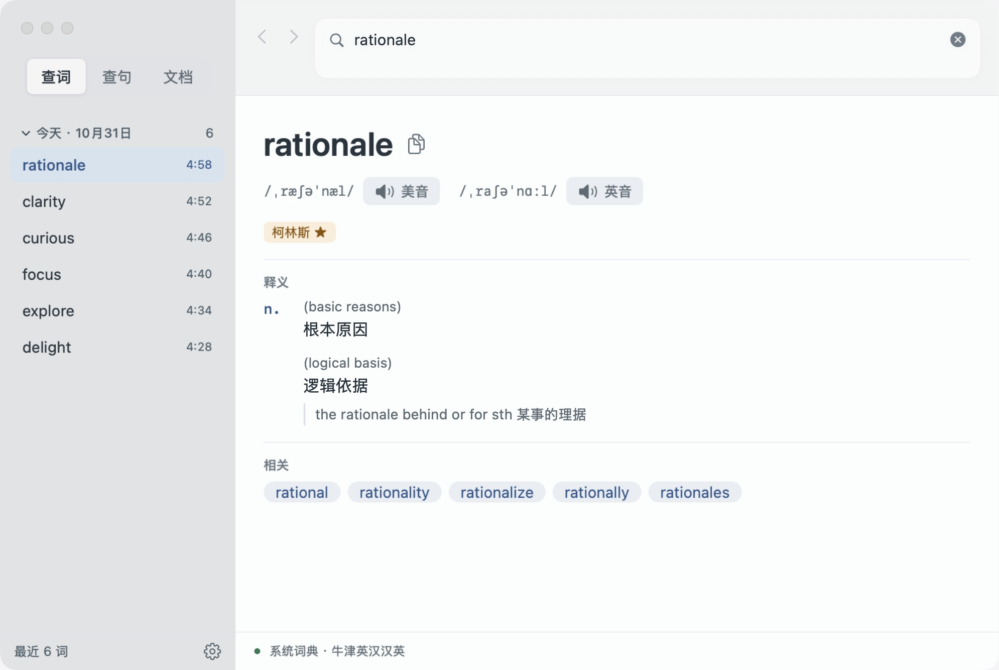
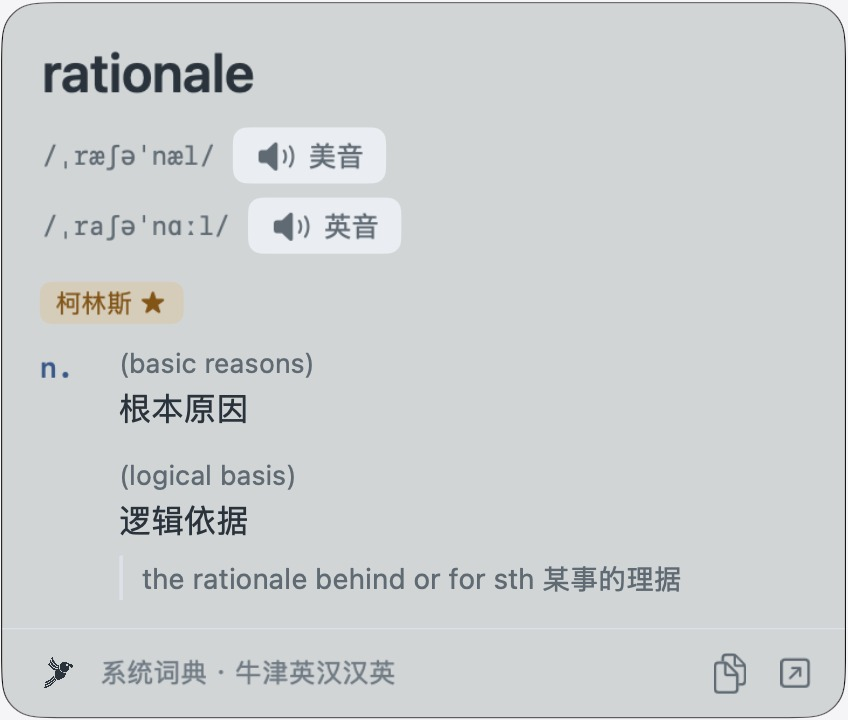
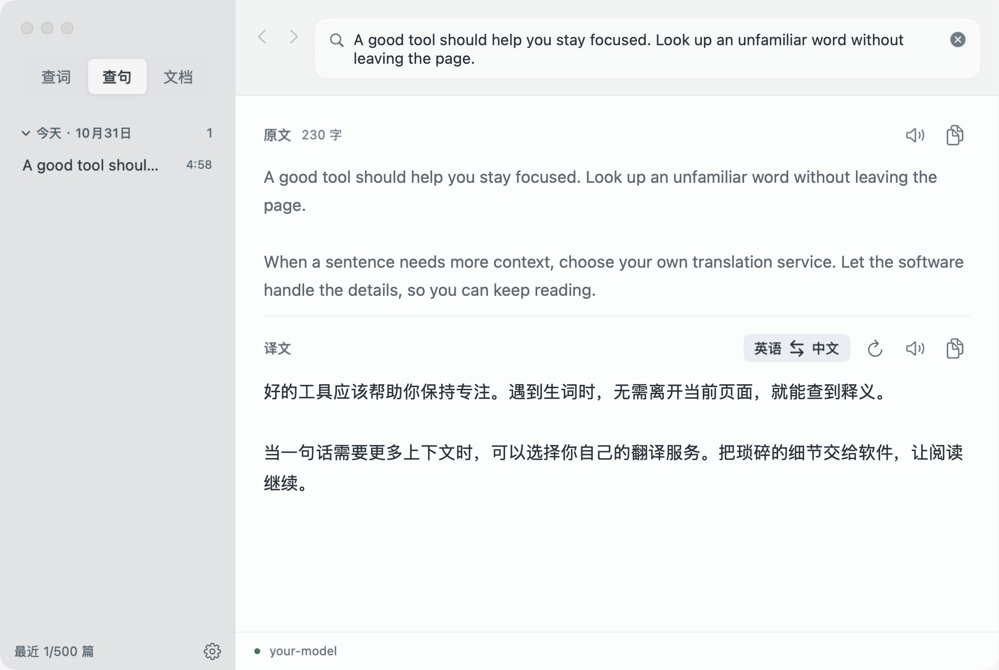
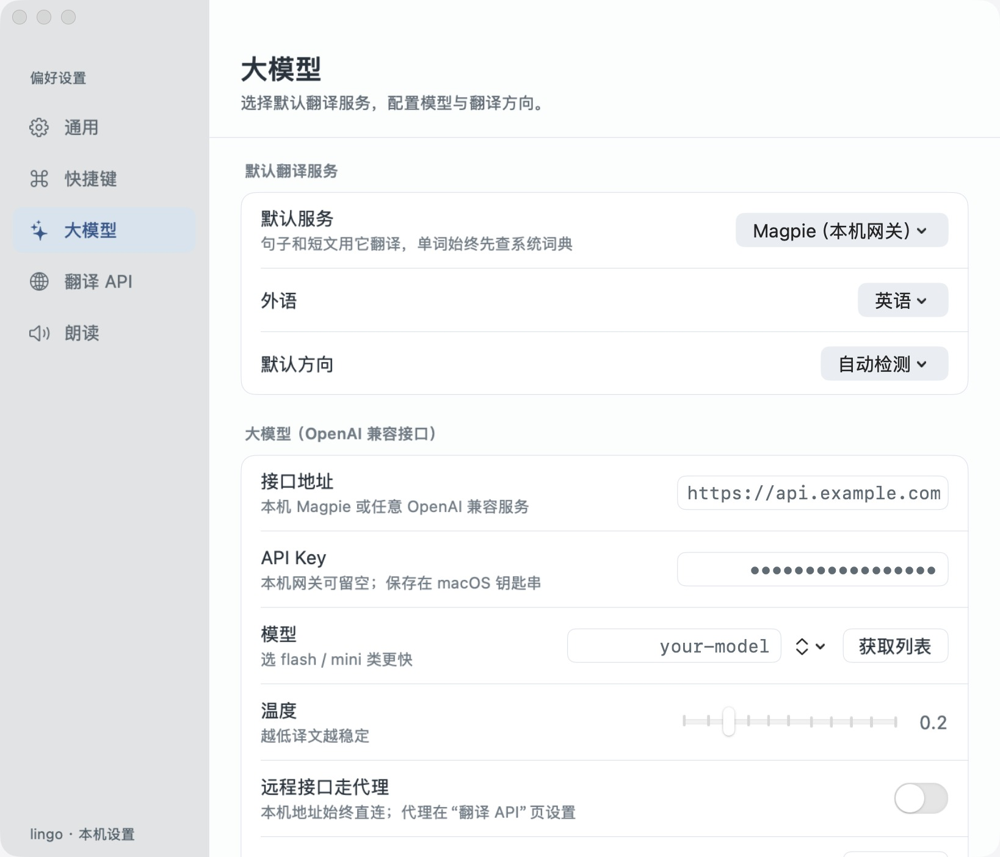

<p align="center"></p>
<h1 align="center">Lingo</h1>
<p align="center">查词快一点，阅读少一次打断。<br>轻量的 macOS 原生菜单栏词典与翻译工具。</p>
<p align="center"><a href="https://lingo.xiezhaoye.site/">官网</a> · <a href="https://kiti-dl.xiezhaoye.site/lingo-0.1.2-macos-arm64.zip">下载 lingo 0.1.2（约 1.4 MB）</a> · <a href="https://github.com/xiezhaoye/lingo/releases/latest">GitHub Releases</a> · <a href="https://github.com/xiezhaoye/lingo/issues">问题反馈</a></p>



## 1. 本机词典，选中就查

单词直接查询 macOS 本机系统词典，无需联网，也不消耗大模型额度。在浏览器、PDF 或聊天窗口中选中文字，释义浮层出现在鼠标旁，不抢焦点；支持美音／英音、例句和继续双击查词。系统词典需已安装对应词典数据。

全局快捷键随时可用：`⌥D` 开关自动取词，`⌥Q` 快速查询，`⌥空格` 打开主窗口。均可在设置中修改。



[查看全局快捷键设置截图](landing/assets/lingo-keys.jpg)

## 2. 整句与文章，用你自己的翻译服务

配置翻译 API 或大语言模型的接口地址、模型和 Key，即可翻译句子、段落和文章。支持 OpenAI 兼容接口，以及 Google 翻译、DeepL；大模型支持流式输出，Key 保存在 macOS 钥匙串。





[查看整句翻译浮层](landing/assets/lingo-sentence.jpg) · [查看 Google / DeepL API 配置](landing/assets/lingo-api.jpg)

还支持 txt、md、docx、有文字层的 PDF、rtf 和 html 文档，分段并发翻译，可取消、重译和导出。查词、文章、文档历史分别保存，按天回看。

> 截图来自当前原生界面；文章、历史及接口配置均为演示数据，译文为展示文案，不代表某个模型的实际测试结果。

## 3. 小体积，原生运行

- **下载约 1.4 MB，应用约 4.7 MB**：0.1.2 Apple Silicon ZIP 实测，未内置大模型权重。
- **SwiftUI + AppKit**：没有 Electron、内嵌浏览器或第三方运行时依赖。
- **菜单栏待命**：关闭窗口后默认继续取词；不翻译时无需后台模型推理。本地查词不发网络请求。
- 本机空闲参考：主窗口打开、没有翻译任务，连续 10 秒采样 CPU 读数为 0.0%，RSS 约 117 MiB。此为发布前本机进程样本，不是跨设备性能保证；[条件和测量方式](docs/release-0.1.2.md)。

## 默认快捷键

| 操作 | 快捷键 |
|---|---|
| 自动取词开关 | `⌥D` |
| 打开主窗口 | `⌥空格` |
| 快速查询 | `⌥Q` |
| 翻译剪贴板内容 | `⌥⇧T` |
| 朗读选中文字 | `⌥S` |
| 放大 / 缩小界面 | `⌥＋` / `⌥－` |

全局快捷键均可在设置中修改。

## 安装

要求 macOS 13+、Apple Silicon。[下载 lingo 0.1.2](https://kiti-dl.xiezhaoye.site/lingo-0.1.2-macos-arm64.zip)，或前往 [GitHub Releases](https://github.com/xiezhaoye/lingo/releases/latest)。解压后将 **lingo.app** 拖入“应用程序”。

安装包未经 Apple 公证：若提示无法验证开发者，在“系统设置 → 隐私与安全性”选择“仍要打开”。首次使用需在“辅助功能”里允许 lingo，用来读取其他 App 中选中的文字。已有 kiti 用户的历史、钥匙串和应用标识保持兼容。

## 常见问题

**需要联网或大模型吗？**

查单词不需要联网，前提是本机已安装系统词典数据。翻译句子和文档需要你自己配置的翻译服务；本地模型服务也可以通过兼容接口接入，其资源占用不计入 lingo 本体。

**我的文字会上传吗？**

本机词典查询不上传文字。句子与文档发送到你配置的接口，lingo 没有自己的翻译服务器，也不含统计脚本。API Key 存钥匙串；历史保存在本机，可导入、导出或指定文件夹多机合并。

**支持扫描版 PDF 吗？**

暂不支持；带文字层的 PDF 可正常翻译。

**关掉窗口后 lingo 去哪了？**

默认留在菜单栏继续取词。可在设置 → 通用里改为“关闭主窗口时退出”，或在 Dock 中显示。

## 从源码构建

```bash
cd app
LINGO_SKIP_INSTALL=1 ./build.sh  # 编译并签名到 build/lingo.app
# 首次安装且 /Applications/lingo.app 不存在时，可直接运行 ./build.sh
```

SwiftPM 工程，无第三方包依赖。分发包为 Apple Silicon；其他架构需自行构建，尚未测试。

## 更多信息

- [0.1.2 发布记录](docs/release-0.1.2.md)：版本变化、安装包校验值与资源测量说明。
- `app/`：应用源码和构建脚本。
- `landing/`：产品官网和公开演示截图。

[MIT License](LICENSE)。
